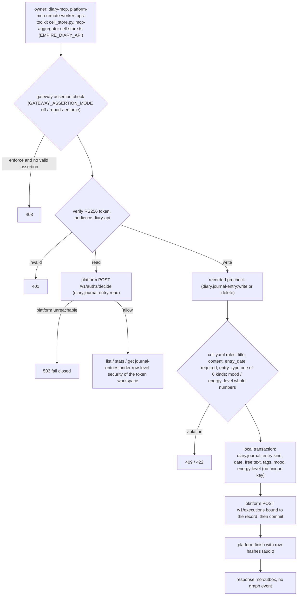

# 01 — Business process (As-Is / To-Be)

life-diary-api คือ cell (restricted) ที่เก็บบันทึก journal ส่วนตัวของ owner: ชนิดบันทึก วันที่ ข้อความ tag และค่า mood / energy แบบตัวเลข ผู้เรียกคือ owner ผ่าน `diary-mcp`, hosted tool hub และ owner tooling (ops-toolkit `cell_store.py`, mcp-aggregator) ด้วย token ของ `empire-platform`; ไม่มีหน้าเว็บใดอ่าน cell นี้ และไม่ส่ง graph event

Last reviewed: 2026-11-27 · commit `60246d2`

## As-Is (จากโค้ดวันนี้)

Sources: `cell.yaml`, `migrations/0001_diary.sql`, `pyproject.toml` (pinned `platform-cellkit` 1.0.11: `cellkit/app.py` `allow`, `write`, `emit`, erase route; `cellkit/server.py` gateway install; `cellkit/spec.py` `audience`), `README.md`, `PRODUCT.md` §Users

ข้อเท็จจริงสำคัญจากโค้ด:

- resource เดียว `/v1/journal-entries` (filter `entry_type`): list, stats (group by `entry_type` เท่านั้น), get, get-by-legacy-id, create (`Idempotency-Key`), patch (`expected_version`), delete และ `POST /v1/journal-entries/erase` (ลบทั้ง workspace ของผู้เรียกเป็น batch, ต้องมี `diary.journal-entry:delete` และยืนยัน workspace id ของตัวเอง)
- ข้อมูลเป็นข้อความส่วนตัว: ไฟล์นี้บอกเฉพาะชนิดข้อมูล ไม่มีตัวอย่างบันทึก
- ไม่มี `graph:` ใน `cell.yaml` จึงไม่เขียน outbox และไม่มี service publisher; การเขียนทุกครั้งมีเฉพาะ execution และ audit (row hashes) ที่ platform
- cell สร้างว่างเมื่อ 2026-10-11 (ตาราง SQLite เดิมไม่มีแถว)
- `GATEWAY_ASSERTION_MODE` ค่าเริ่มต้น `off`; ค่าที่ใช้ใน production [ต้องยืนยัน]

## To-Be

ไม่มี To-Be ที่เขียนไว้

## Gap

| ID | As-Is → To-Be | Status | Owner | Evidence |
|---|---|---|---|---|
| G1 | ไม่มี To-Be ที่เขียนไว้ (PRODUCT.md มีแค่ตัววัดที่เสนอโดยไม่มีเป้า, specs เป็นงาน baseline / test) → owner กำหนด To-Be ของ cell นี้ | decide | owner | `PRODUCT.md` §Measures ("Proposed (nothing collects them yet)"); `specs/001-l2-baseline/spec.md`, `specs/002-cellkit-test-depth/spec.md` |

## Open questions

- `GATEWAY_ASSERTION_MODE` ใน production เป็น `report` หรือ `enforce` [ต้องยืนยัน]
